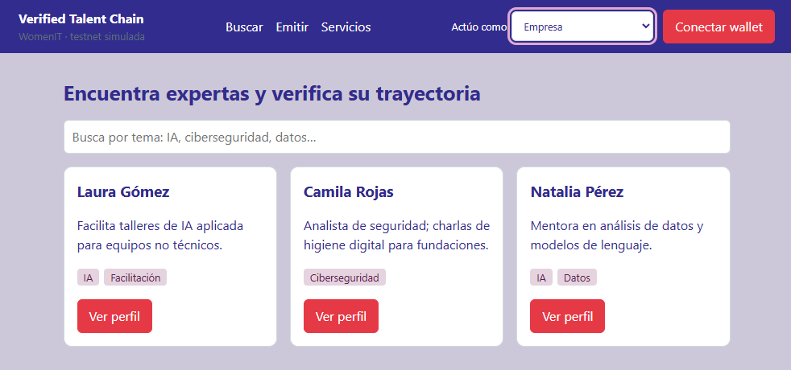
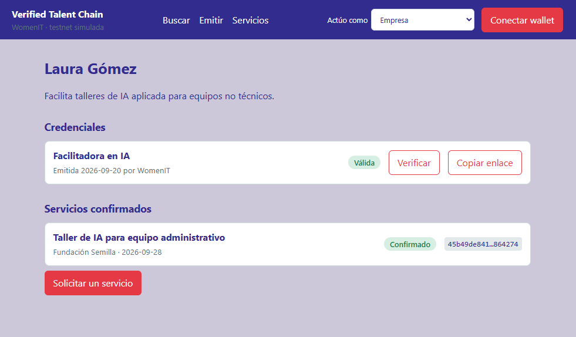
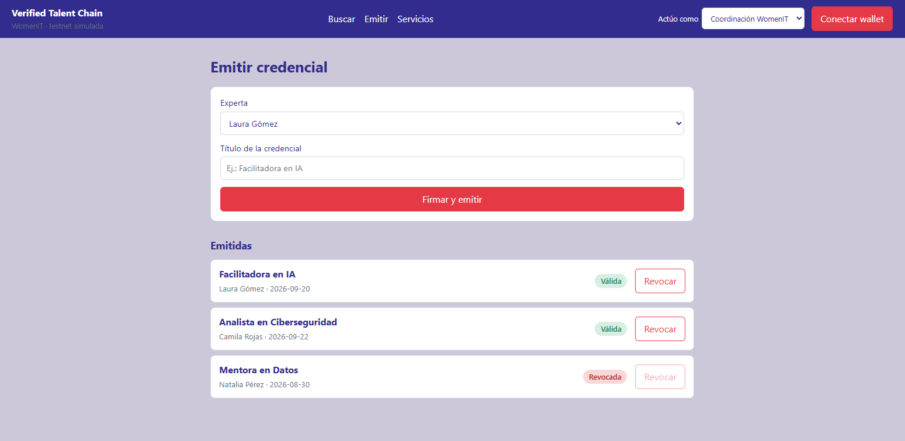
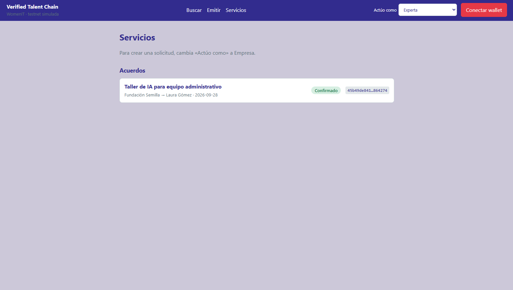
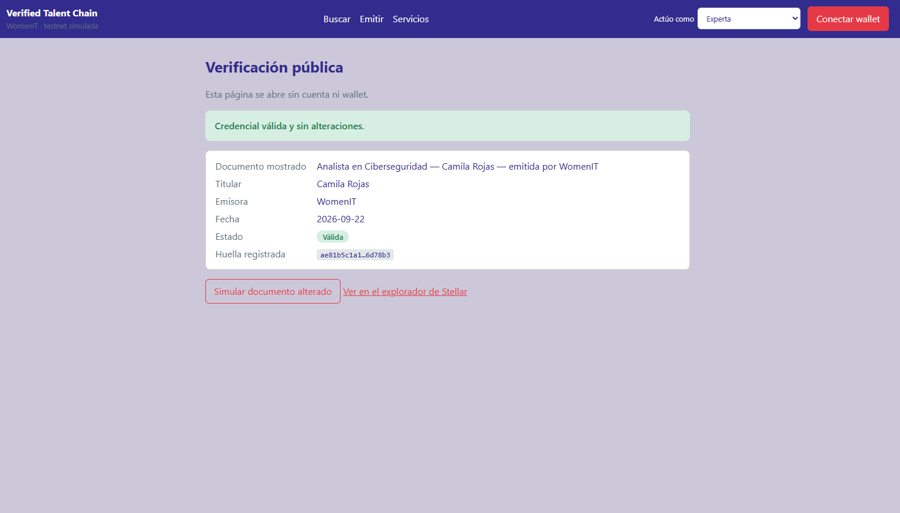
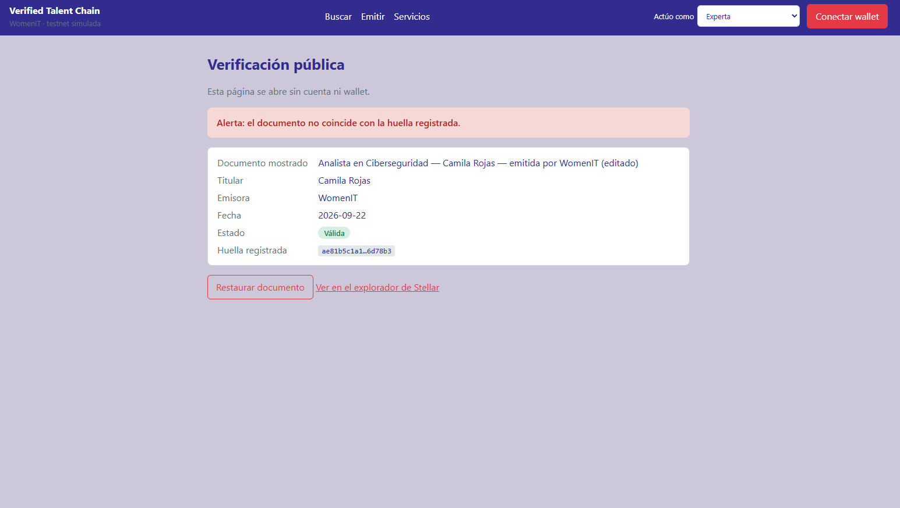

# Documentación semana 3 — Verified Talent Chain (WomenIT)

## 1\. Front construido

**Enlace al front desplegado:**  (pendiente desplegar)

**Capturas:** 

El front es una aplicación web en React + Vite (`frontend/`) que recorre el flujo principal del MVP definido en el Product Blueprint: **emitir → verificar → contratar → confirmar → evidencia reutilizable**. Esta semana funciona con **datos de prueba simulados**: no hay llamadas a Stellar, la wallet es una simulación y la huella de los documentos es un cálculo local de demostración. El objetivo es dejar validado el recorrido de cada rol antes de conectar el contrato en la semana 4.

Para poder probar todos los roles en una sola sesión, la barra superior incluye el selector **«Actúo como»** (Coordinación de WomenIT, Experta, Empresa) y el botón **«Conectar wallet»**, que simula Freighter. Cada acción que en producción requerirá firma (emitir, revocar, aceptar, confirmar) exige tener la wallet conectada y muestra los estados «firmando» y «transacción confirmada».

### Pantallas implementadas

| Pantalla             | Ruta            | Paso del flujo del Blueprint                                                  | Tarjeta    |
| -------------------- | --------------- | ----------------------------------------------------------------------------- | ---------- |
| Búsqueda de expertas | #/buscar        | 3. La empresa busca expertas por tema                                         | T-07       |
| Perfil de la experta | #/perfil/:id    | 2. La experta recibe y comparte su credencial; 9. Evidencia en su trayectoria | T-03       |
| Emisión y revocación | #/emitir        | 1. WomenIT emite una credencial (formulario y firma con wallet)               | T-02       |
| Verificación pública | #/verificar/:id | 4 y 10. La empresa o un tercero verifica sin cuenta                           | T-04       |
| Servicios y acuerdos | #/servicios     | 5 a 8. Solicitud, aceptación firmada y confirmación de la empresa             | T-05, T-06 |

### Cómo se recorre

1.  **Coordinación** abre «Emitir», elige una experta, escribe el título de la credencial y pulsa «Firmar y emitir». La credencial aparece como válida y puede revocarse; al revocarla cambia de inmediato a «Revocada».
2.  **La experta** tiene un perfil con sus credenciales, el estado de cada una y un botón «Copiar enlace» que genera el enlace público de verificación.
3.  **La empresa** busca por tema (IA, ciberseguridad, datos), abre un perfil y puede verificar cada credencial.
4.  **La verificación pública** no pide cuenta ni wallet. Muestra titular, emisora, fecha, estado y huella registrada, y compara la huella con el documento mostrado. El botón «Simular documento alterado» permite ver la alerta cuando no coinciden. Incluye un enlace al explorador de Stellar testnet.
5.  **El servicio:** como Empresa se envía una solicitud con alcance y fecha (queda «Pendiente»). Como Experta se acepta y firma («Aceptado»). Como Empresa se confirma el servicio («Confirmado») y se genera la evidencia, que aparece en el perfil de la experta.

Las reglas del Blueprint ya se reflejan en la interfaz: solo Coordinación emite y revoca, solo la experta acepta el acuerdo y solo la empresa lo confirma. En la semana 4 esas mismas reglas pasarán a hacerse cumplir en el contrato y no solo en la interfaz.

### Datos simulados

Las expertas, credenciales y el servicio de ejemplo son ficticios (`frontend/src/data.js`). Los datos personales no se guardan en la red, tal como define la arquitectura del Blueprint.

## 2\. Decisión técnica

**Opción elegida: A. Contrato propio en Soroban.**

**Qué haría el contrato.** Según el Blueprint, la red entra solo donde se necesita confianza compartida. El contrato registraría: (1) las **emisoras autorizadas**, empezando por WomenIT; (2) cada **credencial**, con la huella del documento, la emisora, la titular, el estado (válida o revocada) y el sello de tiempo; (3) cada **acuerdo de servicio**, que solo queda registrado cuando firman la experta y la empresa; y (4) la **evidencia** de servicio confirmado, que solo puede firmar la empresa que suscribió el acuerdo y una sola vez. La lectura sería pública: un tercero consulta el estado por RPC sin cuenta ni permiso de WomenIT.

**Por qué hace falta uno propio.** El valor del producto está en las **reglas**, no solo en guardar datos: que solo una emisora autorizada pueda emitir, que solo ella revoque sus credenciales, que el acuerdo exija ambas firmas y que la confirmación no pueda repetirse. El Blueprint plantea que estas reglas se apliquen en el contrato mediante la autorización de Soroban (`require_auth`), no en un servidor, para que nadie pueda falsificar lo que otra parte debe acreditar y para que la verificación sobreviva si WomenIT o el servidor desaparecen.

**Qué se descartó.**

-   **Opción B (solución existente del ecosistema).** Las operaciones nativas de Stellar y las herramientas ya disponibles permiten guardar un dato o mover un activo, pero no imponen reglas de negocio como las anteriores ni ofrecen un registro consultable de emisoras, credenciales y acuerdos. Para usarlas habría que llevar esa lógica a un servidor propio, lo que contradice la razón de usar la red: que la verificación no dependa del emisor.
-   **Guardar datos personales en la red.** Se descartó por privacidad. Solo se registran huellas y estados; los textos y datos de la experta viven en la base de datos.
-   **Pagos con activos digitales.** Quedan fuera del MVP, como indica el Blueprint.

No se escribe ni se despliega ningún contrato esta semana. La implementación (tarjeta T-01) se hará en la semana 4, solo en testnet.

## 3\. Participación del equipo

| Integrante        | Usuario de GitHub | Aporte                                                                                  |
| ----------------- | ----------------- | --------------------------------------------------------------------------------------- |
| Zurisadai Agudelo | zagu5             | Diseño y construcción del front, decisión técnica de contratos, documentación y README. |

## 4\. Bloqueos y siguiente paso

**Pendiente**

-   La wallet, las firmas, las huellas y los datos son simulados; el front aún no lee ni escribe en Stellar.
-   No hay base de datos ni lógica de servidor para perfiles y documentos.
-   El enlace del tablero Kanban y el del front desplegado están por completar.

**Siguiente paso hacia el MVP (semana 4)**

1.  Escribir y probar el contrato Soroban (T-01) y desplegarlo en testnet.
2.  Generar los bindings de TypeScript y conectar la wallet real con Stellar Wallets Kit.
3.  Reemplazar los datos simulados por lecturas del contrato (verificación pública) y por firmas reales (emisión, aceptación y confirmación).
4.  Organizar el código del front por capas (componentes, hooks, servicios), como en la demo de clase.
